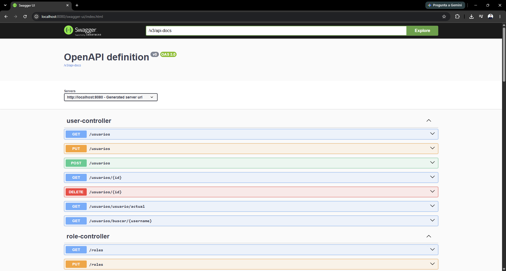

# FacturaPro — Backend

REST API for **FacturaPro**, a web application for managing discounted invoice and bill-of-exchange portfolios (*carteras de descuento*). It lets a company register its invoices (*facturas*) and bills of exchange (*letras*), group them into portfolios linked to a bank, and calculate the net amount received and the portfolio's annual effective cost rate (**TCEA**).

> Academic project for the course *Finanzas e Ingeniería Económica* (SI642), Universidad Peruana de Ciencias Aplicadas (UPC), 2024-2.

- **Frontend (Angular):** [Carlou134/TF_FINANZAS_FRONTEND](https://github.com/Carlou134/TF_FINANZAS_FRONTEND)

## The problem

Small and medium-sized businesses often need cash before their customers pay. A company holding an invoice for S/ 10,000 due in 90 days can discount it with a bank and get the money today, minus interest, fees and taxes. FacturaPro automates that analysis: how much the company actually receives and what the operation really costs.

## Features

- **Authentication:** user registration and login with JWT (stateless) and role-based access.
- **Banks:** create, list, update and delete banks.
- **Exchange rate:** store USD values and fetch the latest one for currency conversion.
- **Debtors:** manage the debtors associated with each document.
- **Portfolios:** create portfolios per user, with a bank, discount date and currency (PEN or USD).
- **Documents:** manage invoices and bills of exchange within a portfolio: nominal value, issue and due dates, currency, nominal or effective rate, capitalization period, fees (postage, study, disbursement and collection fees) and IGV tax.
- **Portfolio calculations:** compute the portfolio's total nominal value, total net value and TCEA, converting between soles and dollars when needed.

## Tech stack

| Layer          | Technology                                  |
| -------------- | ------------------------------------------- |
| Language       | Java 17                                     |
| Framework      | Spring Boot 3.3.4 (Web, Data JPA, Security) |
| Authentication | JWT (`jjwt`)                                |
| Database       | PostgreSQL                                  |
| Mapping        | ModelMapper                                 |
| API docs       | springdoc-openapi (Swagger UI)              |
| Build          | Maven (WAR packaging)                       |
| Deployment     | Heroku (`Procfile`)                         |

## Architecture

The backend uses a classic layered architecture:

```
Angular (Netlify) ──HTTP/JSON + JWT──▶ Controllers ─▶ Services ─▶ Repositories ─▶ PostgreSQL
```

```
src/main/java/pe/edu/upc/aaw/tf_finanzas/
├── controllers/          # REST endpoints
├── dtos/                 # Data transfer objects
├── entities/             # JPA entities
├── repositories/         # Spring Data JPA repositories
├── security/             # JWT filter, token util, security config
├── servicesinterfaces/   # Service contracts
├── servicesimplements/   # Business logic and financial calculations
└── util/                 # CORS configuration
```

### Data model

Seven tables: `users`, `roles`, `bancos`, `valor_dolar`, `deudores`, `cartera` and `documentos`.

- A **portfolio** (`cartera`) belongs to one **user** and one **bank**.
- A **document** (`documentos`) belongs to one **portfolio** and one **debtor**.
- `valor_dolar` provides the exchange rate used to convert documents to the portfolio's currency.

## Financial logic

The portfolio calculation lives in `CarteraServiceImpl.updateCalculos` and is triggered with `PUT /cartera/calculos/{id}`. For each document it:

1. Converts the discount rate into an effective annual rate (TEA).
2. Adds up the costs: postage, fees and IGV.
3. Discounts `(nominal value − costs)` to present value over the document's term.
4. Converts the result to the portfolio currency using the latest USD value, if needed.

It then computes the consolidated TCEA from the total nominal value (`S`) and the total net value (`C`) on a 360-day year:

```
TCEA = (S / C)^(360 / 360) − 1
```

## API overview

All endpoints except the public ones require the header `Authorization: Bearer <token>`.

| Resource       | Base path     | Notes                                                                                  |
| -------------- | ------------- | -------------------------------------------------------------------------------------- |
| Auth           | `/login`      | `POST`, public. Returns a JWT                                                          |
| Users          | `/usuarios`   | Registration is public. `GET /usuarios/usuario/actual` returns the current user        |
| Roles          | `/roles`      | Public                                                                                 |
| Banks          | `/bancos`     | CRUD                                                                                   |
| Exchange rate  | `/dolar`      | CRUD + `GET /dolar/valor` (latest value)                                               |
| Debtors        | `/deudores`   | CRUD                                                                                   |
| Portfolios     | `/cartera`    | CRUD + `GET /listar/carteraporusuario`, `GET /dias-cartera/{id}`, `PUT /calculos/{id}` |
| Documents      | `/documentos` | CRUD + `GET /listar/{idCartera}`                                                       |

CRUD endpoints follow the same pattern: `POST /`, `GET /`, `GET /{id}`, `PUT /`, `DELETE /{id}`.

Interactive documentation is available at `http://localhost:8080/swagger-ui/index.html` once the app is running.



### Example: calculate a portfolio's TCEA

**1. Log in and get a token**

```bash
curl -X POST http://localhost:8080/login \
  -H "Content-Type: application/json" \
  -d '{"username": "demo", "password": "demo123"}'
```

```json
{ "jwttoken": "eyJhbGciOiJIUzUxMiJ9..." }
```

**2. Recalculate the portfolio** (after adding its documents)

```bash
curl -X PUT http://localhost:8080/cartera/calculos/1 \
  -H "Authorization: Bearer <token>"
```

**3. Read the results**

```bash
curl http://localhost:8080/cartera/1 \
  -H "Authorization: Bearer <token>"
```

```json
{
  "id": 1,
  "bancos": { "id": 1, "nombre": "Banco Demo", "codigo": "BD01", "ruc": "20123456789" },
  "fecha_descuento": "2024-11-15",
  "moneda": "PEN",
  "total_valor_nominal": 10000.0,
  "total_valor_neto": 9600.0,
  "tcea": 4.1667,
  "estado": "Activo"
}
```

*Values are illustrative. The `usuarios` field is omitted for brevity.*

## Getting started

### Prerequisites

- JDK 17
- PostgreSQL 14+ (any recent version should work)

### Configuration

The configuration is read from environment variables:

| Variable      | Required | Default                                       |
| ------------- | -------- | --------------------------------------------- |
| `DB_URL`      | No       | `jdbc:postgresql://localhost:5432/facturapro` |
| `DB_USERNAME` | No       | `postgres`                                    |
| `DB_PASSWORD` | Yes      | —                                             |
| `JWT_SECRET`  | Yes      | — (Base64-encoded, at least 64 bytes)         |
| `PORT`        | No       | `8080`                                        |

You can generate a secret with `openssl rand -base64 64 | tr -d '\n'`.

With `ddl-auto=update`, Hibernate creates the tables on first run.

### Run

```bash
export DB_PASSWORD=your_password
export JWT_SECRET=your_base64_secret
./mvnw spring-boot:run
```

The API starts at `http://localhost:8080`.

### Deploy to Heroku

The included `Procfile` runs the packaged WAR:

```
web: java -Dspring.profiles.active=default -Dserver.port=$PORT -jar target/*.war
```

Set the variables as config vars, e.g. `heroku config:set DB_URL=... DB_USERNAME=... DB_PASSWORD=... JWT_SECRET=...`.

## Known limitations

- The TCEA is computed from portfolio totals, not from each document's dated cash flows.
- There are no unit tests for the financial formulas yet.

## Context

Built as the final project for SI642 at UPC (Group 02), November 2024.
